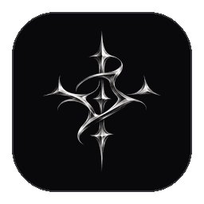

<p align="center">
  
</p>

<h1 align="center">Antigravity Board</h1>

<p align="center">
  <strong>Local analytics dashboard for Google Antigravity (App, IDE &amp; CLI) by BreezeAI.</strong><br>
  Track sessions, agent time, tokens, estimated API cost, test status, and your 12-week activity heatmap — 100% locally, right inside Antigravity.
</p>

---

## Features

- **Native Antigravity MCP App**:
  - **Full-page sidebar button**: Open **Plugins → Antigravity Board** from the left sidebar in Antigravity App.
  - **Side panel view**: Open from the side panel **`+`** menu or run `/antigravity-board` in chat.
  - **Live Sync button**: Resync all sessions in place without leaving Antigravity.
- **Unified across all Antigravity surfaces**: Reads local session histories from **Antigravity App**, **Antigravity IDE**, and **Antigravity CLI** (`~/.gemini/antigravity*`), skipping background subagents automatically.
- **Auto-sync hook**: Bundled `Stop` hook updates the current session silently after every turn.
- **100% Local & Zero Runtime Dependencies**: All data stays in `~/.config/antigravity-board/`. Pre-bundled `dist/` works immediately after `agy plugin install` with Node.js `>= 22.13` (uses built-in `node:sqlite`).
- **Share Card export**: Export dark-themed summary cards as **PNG** or **SVG** with BreezeAI branding.

## Install

Install directly as a global Antigravity plugin (works across Antigravity App, Antigravity IDE, and Antigravity CLI):

```bash
agy plugin install https://github.com/thanhphong28/antigravity-board
```

Restart Antigravity App (or reload MCP servers) and click **Plugins → Antigravity Board** in the left sidebar — your historical sessions sync automatically on first open.

### Usage

- **Antigravity App**: Click **Plugins → Antigravity Board** (full page) or **`+` → Antigravity Board** (side pane), or type `/antigravity-board`.
- **Antigravity IDE / CLI**: Run `/antigravity-board` or open the standalone local HTML file directly:
  ```bash
  node --no-warnings ~/.gemini/config/plugins/antigravity-board/dist/sync.mjs open
  ```

## Development

```bash
npm install
npm run build
npm test
agy plugin validate --strict .
```

## Credits & License

Built by **BreezeAI** ([@thanhphong28](https://github.com/thanhphong28)).  
Board visual layout and SVG stream/heatmap charts adapted from [DietrichGebert/ponytail](https://github.com/DietrichGebert/ponytail) under the MIT License.  
Released under the [MIT License](LICENSE).
